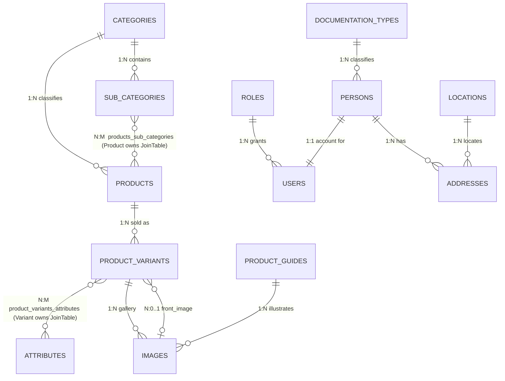

# 03 — Domain Model

Catalog entities live in `src/products/entities/`; the users domain (6 entities, added
2026-11-03) lives in `src/users/entities/`. Every table shares the same housekeeping
convention:

- `id` — `@PrimaryGeneratedColumn('uuid')`
- `created_at` / `updated_at` — `@CreateDateColumn` / `@UpdateDateColumn`, default `CURRENT_TIMESTAMP`
- `deleted_at` — `@DeleteDateColumn` (soft delete; TypeORM automatically excludes soft-deleted
  rows from `find`/`findOne` queries)

Timestamps are `timestamptz` on every entity **except `Product`, which uses `timestamp`**
(inconsistency, see risks doc).

## Entity-relationship diagram

## Entity catalog

### `categories` — `src/products/entities/category.entity.ts`

| Column | Type | Notes |
|---|---|---|
| id | uuid PK | |
| title | varchar(156), **unique** | |
| description | text | |
| image_url | varchar, nullable | |
| view_order | int, nullable | drives `findAll` ordering (`ASC`) |
| Relations | `1:N` → `SubCategory.subCategories`, `1:N` → `Product.products` | |

### `sub_categories` — `src/products/entities/sub-category.entity.ts`

| Column | Type | Notes |
|---|---|---|
| id | uuid PK | |
| title | varchar(156), **unique** | |
| description | text, nullable | |
| image_url | varchar, nullable | |
| Relations | `N:1` → `Category` (required), `N:M` → `Product.products` (inverse side) | |

### `products` — `src/products/entities/product.entity.ts`

The brand-level "parent" of sellable variants. Carries editorial content.

| Column | Type | Notes |
|---|---|---|
| id | uuid PK | |
| brand | varchar | required |
| status | enum `ProductStatus` | `Draft` \| `Published` (default `Draft`). Public catalog filters on `Published` |
| cautions | text[] , nullable | |
| how_to_use | text, nullable | |
| cleaning_care | text[], nullable | |
| Relations | `N:M` → `SubCategory` (**owning side**, join table `products_sub_categories`); `N:1` → `Category`; `1:N` → `ProductVariant` | |

### `product_variants` — `src/products/entities/product-variant.entity.ts`

The sellable unit (has SKU, price, stock). This is what the storefront actually lists.

| Column | Type | Notes |
|---|---|---|
| id | uuid PK | |
| sku | varchar(256), **unique** | lookup key in the manual-sell flow |
| name / description | varchar / text | required |
| specifications | text[], nullable | |
| cost | numeric(12,4) | string in TS |
| price | numeric(12,4) | string in TS |
| discount_price | numeric(12,4), default 0 | string in TS; "has discount" = `> 0` |
| stock | int, default 0 | `isAvailable` is derived from it on update |
| is_available | boolean, default false | |
| views | int, default 0 | incremented on product-page GET |
| total_sales | int, default 0 | incremented by manual sell |
| Relations | `N:M` → `Attribute` (owning side, join table `product_variants_attributes`); `1:N` → `Image.images`; `N:1` → `Product`; `N:0..1` → `Image.frontImage` | |

### `attributes` — `src/products/entities/attribute.entity.ts`

Key/value tags attached to variants (e.g. color, size). No unique constraint on `type`/`value`
— duplicates are possible by design.

| Column | Type | Notes |
|---|---|---|
| id | uuid PK | |
| type | varchar(156) | e.g. "Color" |
| value | varchar(156) | e.g. "Red" |
| Relations | `N:M` → `ProductVariant` (inverse side) | |

### `images` — `src/products/entities/image.entity.ts`

Quasi-polymorphic: each image belongs to **either** a variant **or** a guide (two nullable FKs).
Also referenced as `frontImage` by variants. Columns: `reference` varchar(156), `url`
varchar(1024).

### `product_guides` — `src/products/entities/product-guide.entity.ts`

Editorial buying guides (tests, how-to, expectations, care). Columns: `guide_name`,
`description`, `short_description` (default `''`), `tests` text[], `how_to_use` text[],
`expectations` text, `clean_and_care` text[]; `1:N` → `Image`.

### `documentation_types` — `src/users/entities/doc-type.entity.ts`

Identity document types (seeded: CC, CE, NIT, PPT, TI). Columns: `code` varchar(10), `name`
varchar(48); `1:N` → `Person`.

### `roles` — `src/users/entities/role.entity.ts`

Account roles (seeded: `Admin`, `Customer`). `name` unique, `description` text;
`1:N` → `User`.

### `persons` — `src/users/entities/person.entity.ts`

Natural-person data. `docType` (N:1), `document` varchar(10), `name`/`middle_name`/
`lastname_1`/`lastname_2`, `mail` (unique, lower-cased, `@IsEmail`-validated), `phone`
(unique); `1:N` → `Address`.

### `users` — `src/users/entities/user.entity.ts`

Login account. `username` unique, `password` (bcrypt hash, `@Exclude`d from responses),
`person` (1:1, required — `@JoinColumn` on `personId`), `role` (N:1, required). Soft-deletable.

### `locations` — `src/users/entities/location.entity.ts`

City catalog (Colombia loaded first). `country_code`/`country_name`, `state_code`/`state_name`,
`city_code`/`city_name`; `is_active` boolean default true (per-city enable/disable). Unique
composite index on `(country_code, state_code, city_code)` — catalog re-uploads reject
duplicates per row instead of failing. Bulk load: `POST /locations/massive-upload`.

### `addresses` — `src/users/entities/address.entity.ts`

Person address. `street`, `reference`, `suite`, `zip_code`, `is_billing`/`is_shipping` flags
(both default false); `N:1` → `Location`, `N:1` → `Person`.

## Domain rules worth knowing

- **Soft delete everywhere**: `DELETE /:id` sets `deleted_at` (recycle bin);
  `DELETE /eliminate/:id` physically removes the row.
- **Availability is derived**: `ProductVariantService.updateEntity` sets
  `isAvailable = stock > 0` whenever `stock` is part of the payload
  (`src/products/services/product-variant.service.ts:148`).
- **Catalog visibility**: storefront-style endpoints hard-filter `product.status = Published`.
- **frontImage convention**: on creation, the first image in the payload becomes the variant's
  `frontImage` (`ProductService.createEntity`, `addNewProductVariant`).
- **No Order/Customer/Payment entities exist.** Sales are registered as bare stock movements
  (`PUT /sales/manual-sell`); the commented-out `InlineProduct` design suggests order lines
  were planned and shelved.
